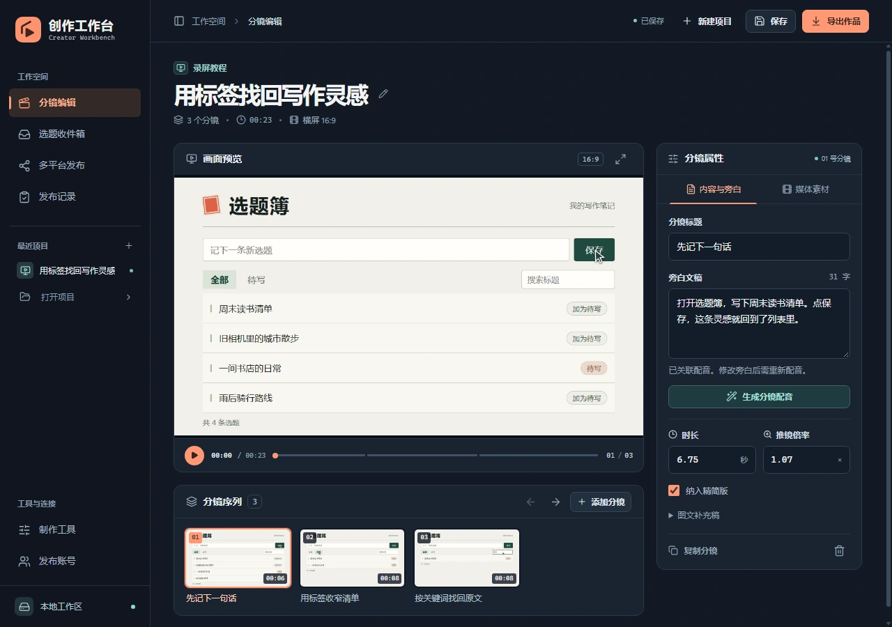

# Creator Workbench · 创作工作台

在自己的电脑上把一个选题做成完整视频、竖版短片和带图教程，再按平台调整和投稿。作品、配音、素材和平台版本保存在同一个可继续编辑的工程里。

[下载安装包](https://github.com/skrqwa/creator-workbench/releases/latest) · [查看安装包测试](https://github.com/skrqwa/creator-workbench/actions/workflows/desktop.yml)



## 从第一期开始

1. 在 Windows 运行对应的 `.exe` 安装程序。在 macOS 打开与芯片匹配的 `.dmg`，把应用拖入「应用程序」。当前个人开源发行包使用 Windows 未签名安装包与 macOS 本地签名。可对照发行页的 SHA256SUMS 核对下载。
2. 打开「录屏教程」或「热点口播」。前者附一个可操作的选题簿练习页、实际操作录屏和分段解说，后者以嫦娥六号为例，附原始出处、图片、旁白及字幕。作品编辑页可改文稿、替换图片和音频、安排分镜顺序和时长。
3. 在「导出作品」生成横版及精简竖版 MP4、封面、PNG 图集和带图 HTML / Markdown 教程。导出物留在工程的 `exports/` 下，可从工作台定位。用「打开工程目录」可在另一台电脑上继续编辑复制过去的完整目录。
4. 在「多平台发布」编辑每个平台自己的标题、正文、封面及素材。选择目标账号后再逐个预览，每个账号独立记录草稿、提交、审核及失败情况。首次体验可直接在本地完成制作与导出。

## 收集选题和制作

- **选题收件箱**支持 RSS、Atom、GitHub Releases（输入 `owner/repo`）和手工收藏。来源网址及可用的原始发布日期会进入工程。
- **录屏与推镜**可在「制作工具」接入 [OpenScreen 2.3+](https://github.com/getopenscreen/openscreen)。选择程序和目标窗口，录制后会保留 OpenScreen 工程、窗口视频及可用的光标轨迹。也可导入已调好镜头的 `.openscreen` 工程，把导出的片段放进分镜。
- **声音**可直接导入音轨，或配置 [Qwen Voice Clone](https://github.com/skrqwa/qwen-voice-clone) 的 Python、脚本和已授权的 `.pt` 音色模板，按当前分镜的文稿在本机生成 WAV。两套内置示例附现成解说。
- **图文**使用分镜中的图片或录屏截图、引言和讲解生成。文章平台默认使用教程截图，小红书默认使用排好的步骤卡，可在各自版本中修改。

## 发布方式

| 平台 | 可选内容 | 接入方式 |
| --- | --- | --- |
| 抖音 | 视频、图集 | 登录创作页复核；通过已授权的 AiToEarn 插件提交；视频另支持抖音开放平台接口 |
| 小红书 | 图文卡片、视频 | 登录创作页复核，或通过插件提交笔记 |
| B站 | 视频、专栏 | 投稿页复核；获开放平台授权后投稿并查询稿件状态 |
| 微信视频号 | 视频、封面 | 视频号助手复核，或通过插件提交 |
| 微信公众号 | 教程长文 | 官方接口上传正文配图和封面、写入草稿箱；有发表接口权限的机构账号可提交，个人主体在后台发表 |
| 快手 | 视频 | 创作者页复核，或通过获授权的应用上传、发布并查询 |
| 今日头条 | 图文、视频 | 文章可在头条号保存草稿、从对应草稿确认提交；视频进入创作页复核 |
| 知乎 | 文章、带图想法 | 网页文章草稿；定向授权账号可使用官方文章／想法接口，配图使用官方 MCP 工具 |

添加账号时选「创作网页」「浏览器插件」或「官方接口」。网页账号使用各自的登录窗口。插件在系统浏览器内工作，按插件说明授权 `http://127.0.0.1:24683`，账号填写平台实际昵称或稳定账号 ID。官方接入需要各平台授予的应用和用户权限，凭据在本机通过系统加密保存。知乎配图需事先安装其官方图片上传程序。[插件设置](https://docs.aitoearn.ai/zh/use/plugin-publish/index) · [知乎同步助手](https://github.com/zhihu/ZhihuSync) · [知乎上传工具](https://github.com/zhihu/zhihu-mediacloud-uploader)

「去平台检查」会在编辑器出现后填入内容，页面回显不足会指出需人工补齐的字段。「在工作台确认并提交」根据平台、作品类型和账号权限显示。发布记录保留平台返回的稿件编号、链接及可回查的状态。如果网络中断且平台可能已收到投稿，先在原账号检查作品与草稿，再决定是否补发。平台页面会变化，八个平台仍需分别完成真实授权账号的投稿验收。

平台接口来源见[抖音视频发布](https://developer.open-douyin.com/docs/resource/zh-CN/dop/develop/openapi/video-management/douyin/create-video/video-create)、[B站开放平台](https://open.bilibili.com/doc/)、[微信草稿](https://developers.weixin.qq.com/doc/subscription/api/draftbox/draftmanage/api_draft_add)、[微信发表](https://developers.weixin.qq.com/doc/subscription/api/public/api_freepublish_submit)、[快手视频接口](https://open.kuaishou.com/platformDocs/openAbility/contentManagement/createAVideo.html)和[头条文章交互参考](https://github.com/xwh5/multi-publisher/blob/master/src/adapters/toutiao.ts)。

## 本地开发和构建

使用 Node.js 24 和 npm。首次安装会下载对应平台的 Electron 和 FFmpeg。

```sh
npm ci
npm run dev
```

```sh
npm test
npm run build
npm run smoke
npm run dist
```

`npm run smoke` 使用独立的临时工作区，打开两套示例、修改旁白、替换图片、导出并重启复查。可将 `CREATOR_INSTALLED_EXE` 指向已安装的可执行文件，复测安装版。安装包输出到 `release/`，GitHub Actions 分别在 Windows x64、macOS Apple Silicon 和 macOS Intel 上构建。

自有代码采用 [MIT](LICENSE)。示例和随安装包分发组件的许可分别见[素材署名](examples/CREDITS.md)和[第三方组件](THIRD-PARTY.md)。
